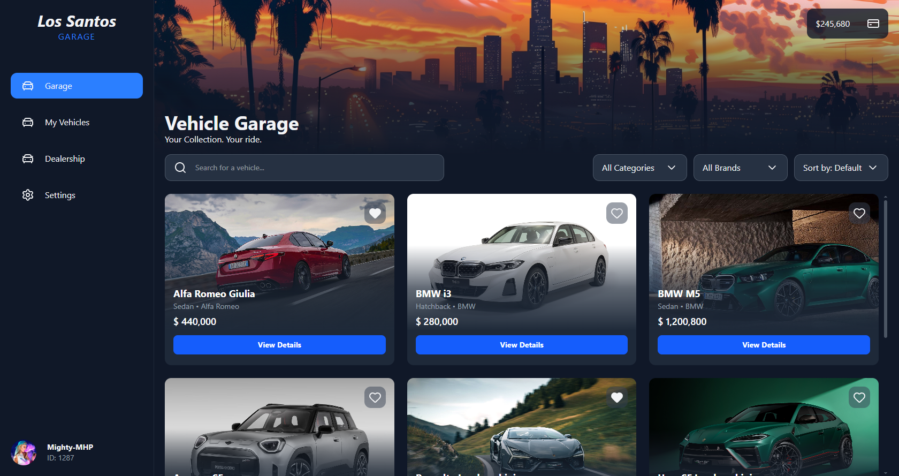
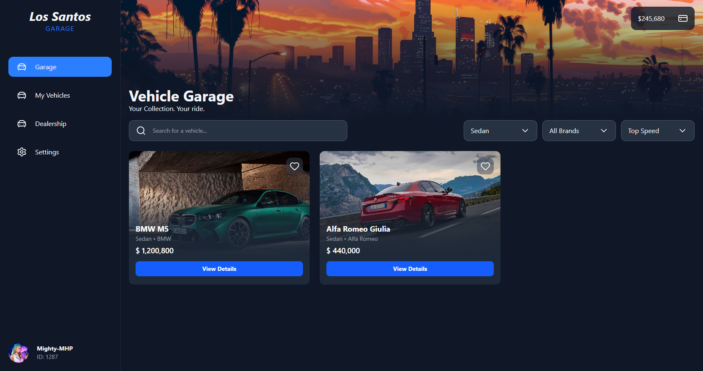
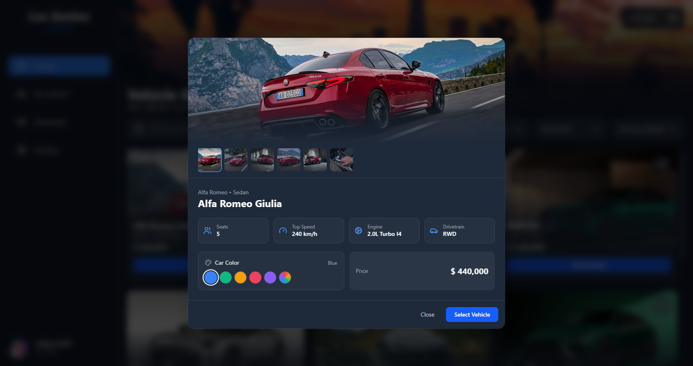

# Vehicle Garage

A modern and interactive vehicle garage interface built with React, TypeScript, and Tailwind CSS.

The project provides a vehicle browsing experience with search, filtering, sorting, and detailed vehicle information. It is designed as a standalone frontend application inspired by vehicle garage systems commonly found in GTA V Roleplay servers.

## Preview







## Features

- **Vehicle Listing:** Browse a collection of vehicles with a clean and responsive interface.
- **Search:** Find vehicles by name.
- **Category Filter:** Filter vehicles by category.
- **Brand Filter:** Browse vehicles from specific brands.
- **Price Filter:** Filter vehicles based on their price.
- **Top Speed Filter:** Filter vehicles according to their maximum speed.
- **Vehicle Details:** View additional information about a selected vehicle, including specifications, price, and available images.
- **Color Selection:** Preview vehicles with different color options.
- **Interactive UI:** Select vehicles and interact with their details.

## Tech Stack

- React 19
- TypeScript
- Vite
- Tailwind CSS 4
- React Router DOM
- Lucide React

## Project Structure

```text
vehicle-garage/
├── public/
├── src/
│   ├── assets/
│   ├── components/
│   ├── db/
│   │   └── sample.data.ts
│   ├── hooks/
│   ├── types/
│   ├── utils/
│   ├── App.tsx
│   └── main.tsx
├── index.html
├── package.json
├── tsconfig.json
└── vite.config.ts
```

## Getting Started

### Prerequisites

- Node.js
- npm

### Installation

Clone the repository:

```bash
git clone https://github.com/mohammad111mhp/vehicle-garage
```

Navigate to the project directory:

```bash
cd vehicle-garage
```

Install dependencies:

```bash
npm install
```

Start the development server:

```bash
npm run dev
```

### Build for Production

```bash
npm run build
```

### Run ESLint

```bash
npm run lint
```

## Project Scope

This project currently focuses on the frontend experience and UI implementation.

- Vehicle information is provided through local sample data.
- No backend or database integration is currently implemented.
- The project is not yet connected to FiveM or VMP.

The interface can serve as a starting point for a future garage system integration.

## License

This project is available for educational and portfolio purposes.
